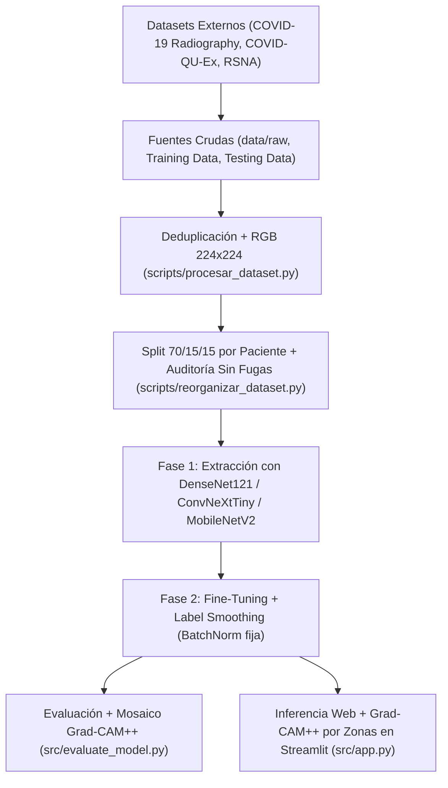

# Documentación Técnica: AI in HealthCare - Chest Disease Detection
**Autor:** Roberto Alejandro Chagra Martínez  
**Tecnologías:** TensorFlow / Keras (DenseNet-121, ConvNeXt-Tiny, MobileNetV2), Grad-CAM / Grad-CAM++, Streamlit, Pillow (PIL), Scikit-Learn, Seaborn, Matplotlib, NumPy, pydicom  
**Tipo:** Clasificación Radiológica Pulmonar Multiclase Explicable con Transfer Learning  

---

## 1. Descripción del Proyecto
Solución de diagnóstico radiológico asistido por Inteligencia Artificial para clasificar enfermedades torácicas (`Bacterial Pneumonia`, `Healthy`, `Viral Pneumonia` y `covid-19`) a partir de radiografías de tórax de $224 \times 224$ píxeles con explicabilidad visual **Grad-CAM / Grad-CAM++**.

---

## 2. Flujo de Datos y Componentes (`Proyectos/lung-pathology-ai`)
* `scripts/ingestar_datasets.py`: Descarga o ingesta local desde `data/downloads/` para **COVID-19 Radiography Database**, **COVID-QU-Ex** y **RSNA Pneumonia (DICOM)** hacia `data/raw/`.
* `scripts/procesar_dataset.py`: Deduplicación por linaje de prefijos, SHA-256 de píxeles y firma perceptual (`dHash-256` + MAE), auditoría de integridad, conversión a `RGB`, redimensionamiento a $224 \times 224$ con `LANCZOS` y exportación en `data/clean/` + `data/clean_manifest.csv` sin modificar orígenes.
* `scripts/reorganizar_dataset.py`: Partición estratificada `70% train / 15% val / 15% test` en `data/processed/` usando `GroupShuffleSplit` por `patient_id` y verificación automática de cero fugas (`data/dataset_manifest.csv`).
* `src/model_utils.py`: Fábrica compartida de backbones (**DenseNet-121**, **ConvNeXt-Tiny**, **MobileNetV2**), preprocesamiento consistente, cálculo de mapas **Grad-CAM / Grad-CAM++** y resumen de activación en 6 zonas radiológicas.
* `src/train_model.py`: Pipeline `tf.data` sobre `data/processed/{train,val}`, Augmentation anatómico nativo, entrenamiento en dos fases con `label_smoothing=0.05`, `compute_class_weight('balanced')` y exportación de `models/modelo_chest_disease.keras`, `config/mapeo_clases.json`, `config/model_config.json` y `results/training_history.json`.
* `src/evaluate_model.py`: Evaluación sin barajado sobre `data/processed/test`, métricas clínicas (`classification_report`, `ROC-AUC`), `results/metricas_evaluacion.json`, `results/matriz_confusion.png` y `results/gradcam_auditoria.png`.
* `src/app.py`: Interfaz web interactiva en **Streamlit** para inferencia, mapa térmico **Grad-CAM / Grad-CAM++** superpuesto con control de opacidad, estimación de zona pulmonar de mayor activación y diseño visual personalizado con la identidad y paleta de **Roberto Alejandro Chagra Martínez (RACM)**.
* `src/api.py`: Micro-servicio HTTP de inferencia y cálculo de gradientes Grad-CAM++ para alimentar aplicaciones externas y clientes móviles.
* Cliente Multiplataforma (**Flutter**): Aplicación en `lung_pathology_ai/` con soporte para Windows Desktop, Web y Android, dependencias en `requirements-flutter.txt` y `pubspec.yaml`, e identidad visual de **Roberto Alejandro Chagra Martínez (RACM)**.
